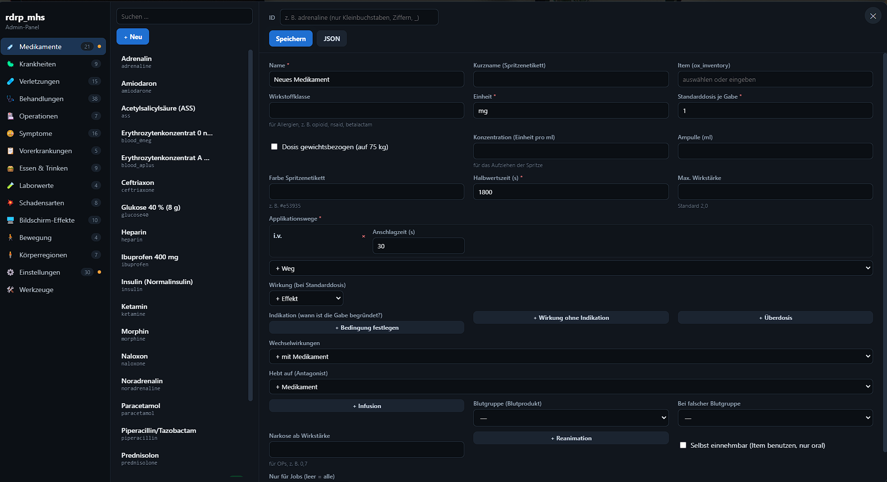

# Medikamente

Beim Erstellen eines Medikaments wird man mit dieser vollen Config-Seite erschlagen, wir bröseln jetzt gemeinsam auf was jede Tabelle hier bedeutet.

<figure><figcaption></figcaption></figure>

### **Schritt 1:**

<figure><figcaption></figcaption></figure>

### **Schritt 2:**

<figure><figcaption></figcaption></figure>

#### **Schritt 2.1:**

<figure><figcaption></figcaption></figure>

### **Schritt 3:**

<figure><figcaption></figcaption></figure>
