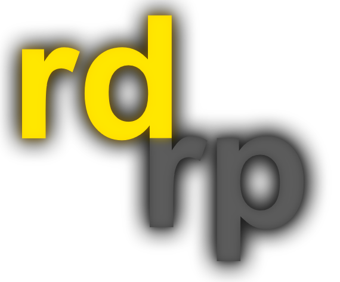

# Über uns

Moin,

wir sind einige Freunde aus dem Norden welche selbst lange Roleplay gespielt haben, wir haben viele coole Systeme kennengelernt aber es fehlte immer dieser, eigentlich völlig unnötige Aspekt "Realismus". Dementsprechend haben wir uns Anfang 2025 gedacht, wir kreieren unser eigenes System, angefangen mit dem r3t. Zugegeben, die ersten Versionen waren extrem schlecht.. Im laufe des Jahres haben wir aber an Qualität gewonnen und konnten uns immer mehr professionalisieren und somit einige Komplexe Systeme aufbauen. Mit der ersten Vollversion des r3t haben wir dann den Durchbruch geschafft, es sind eine Menge Leute auf uns aufmerksam geworden und diese Chance haben wir genutzt!&#x20;

Was bedeutet eigentlich RDRP? Eigentlich ganz einfach Rettungsdienst:Roleplay. Unsere Systeme sind derzeit nur auf die Optimierung des Rettungsdienstes, also der präklinik ausgelegt, was folglich auch die Klinik selbst betrifft. Wir sind selber im Rettungsdienst tätig und haben dadurch unseren ganz eigenen Kontakt zu dem Thema.&#x20;

Was uns am wichtigsten ist, dass Projekt "RDRP" ist für uns ein Hobby, kein FullTimeJob. Dieser Charakter muss bestehen bleiben, denn nur so müssen wir uns nicht zur Arbeit zwingen sondern machen das ganze aus Spaß und Freude.

<figure><figcaption></figcaption></figure>
